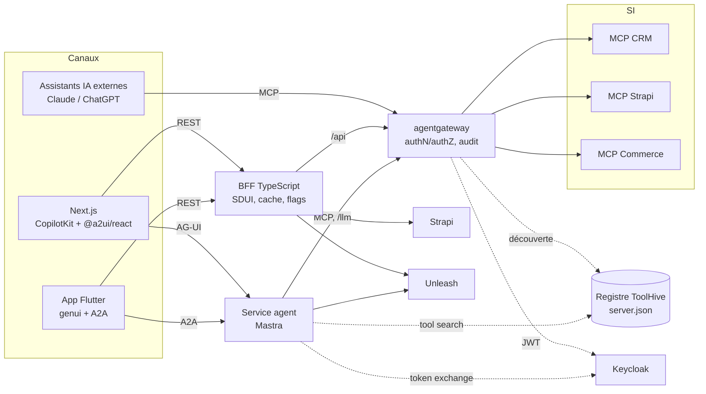
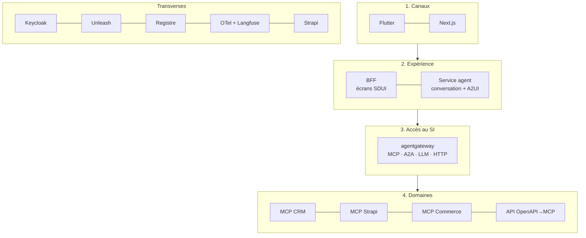
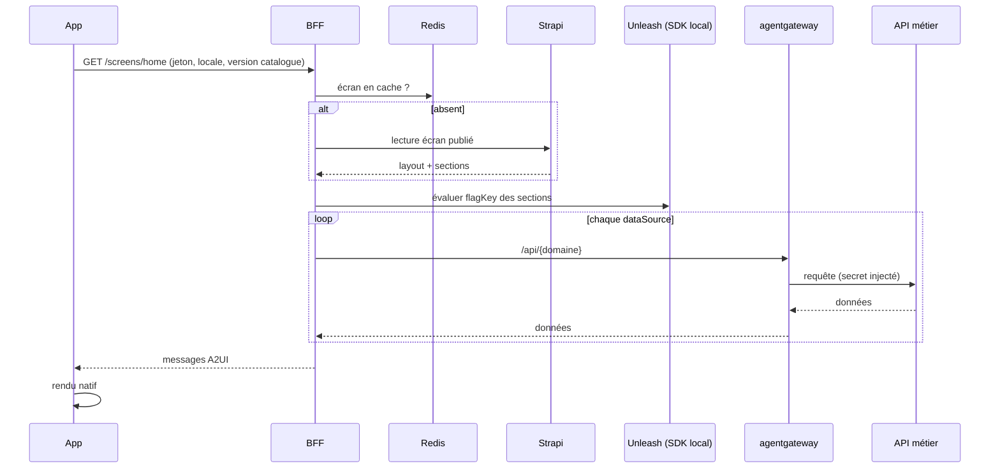
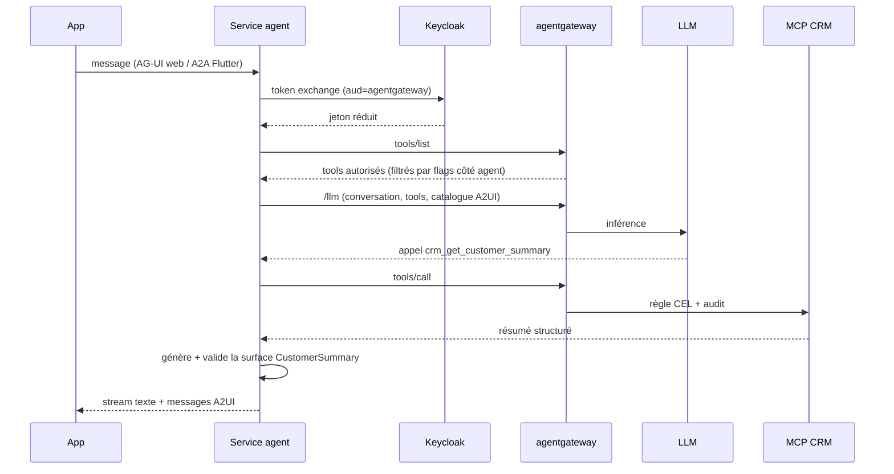
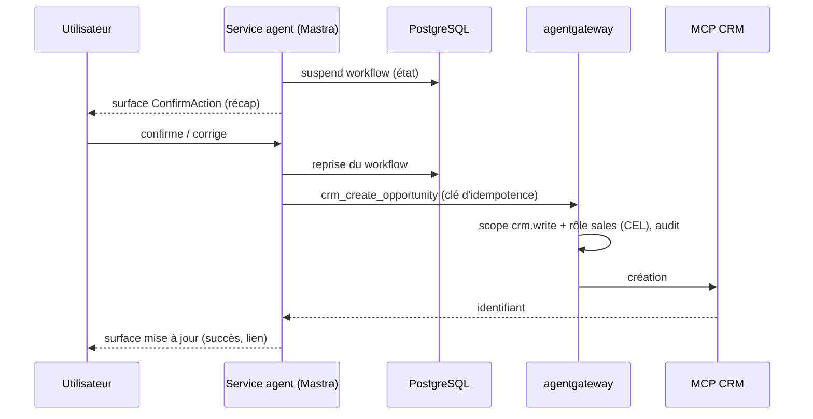
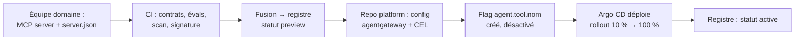

# Diagrammes

> Les schémas du Claude Doc étaient des widgets non exportables en Markdown. Ils sont **reconstruits ici en Mermaid** à partir du texte des documents ; ils restent fidèles aux flux décrits mais ne reproduisent pas la mise en page d'origine. Le plan à 5 phases (~6 mois) n'est pas redessiné.

## Vue d'ensemble

## Architecture détaillée (4 couches + transverses)

## Workflow 1 — Afficher un écran (sans LLM)

## Workflow 2 — Conversation avec UI générée

## Workflow 3 — Écriture avec validation humaine

## Workflow 4 — Ajouter un service au SI

